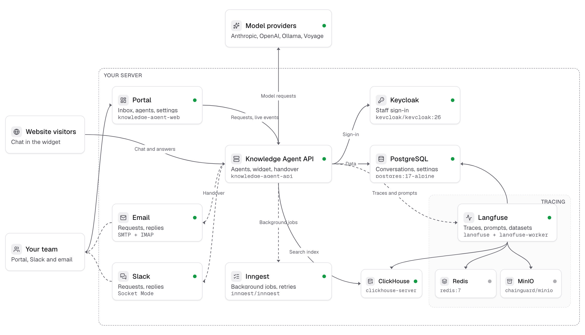

# Knowledge Agent

A self-hosted AI support agent. Add your web pages, files and text, create agents that answer from them with
citations, and put an agent on your website as a chat widget that hands visitors to your team when needed.

## What's inside

- **AI models**: Anthropic, OpenAI and compatible servers, Ollama and Voyage, chosen per role in the portal.
- **Sources**: web pages and whole sites, PDF, TXT and Markdown files and text, searched with vector and keyword
  retrieval.
- **Agents**: each with its own instructions, language, model, knowledge and tools, and specialists to hand off to.
- **Widgets**: a chat for your website from one script tag, styled in a visual editor.
- **Inbox**: every conversation, with handover to a person, labels, contacts and segments.
- **Integrations**: requests by email and Slack, MCP servers as tools for agents, and agents exposed over MCP and
  an HTTP API.
- **Analytics and evaluations**: ratings, unanswered questions, datasets and scored runs, traced in Langfuse.

Stack: .NET 10, PostgreSQL, ClickHouse, Langfuse, Inngest, Keycloak, .NET Aspire, React 19.



## Getting started

Requirements: [.NET SDK 10](https://dotnet.microsoft.com/download), Docker with 6 GB of memory and Node.js 22.

Run the whole stack with Aspire. The first start pulls the container images and takes a few minutes.

```bash
dotnet run --project src/KnowledgeAgent.AppHost
```

or with the [Aspire CLI](https://learn.microsoft.com/dotnet/aspire/cli/overview): `aspire run`.

Or without .NET and Node, with Docker Compose:

```bash
cp .env.example .env && docker compose up --build -d
```

| | Aspire | Docker Compose |
|---|---|---|
| Portal | http://localhost:5173 | http://localhost:8080 |
| API reference | http://localhost:5080/scalar | http://localhost:5080/scalar |
| Aspire dashboard | http://localhost:15180 (login link in the console) | |
| Langfuse | http://localhost:3000 | http://localhost:3000 |
| Inngest | http://localhost:8288 | http://localhost:8288 |
| Keycloak | http://localhost:8180 | http://localhost:8180 |

Sign in with `admin` / `admin` (or `user` / `user` for a support role), then add a chat model and an embedding
model under **AI models**. Langfuse signs admins in through the same Keycloak account.

## Development

```bash
dotnet test --solution KnowledgeAgent.slnx
cd web && npm run lint && npm test
```
